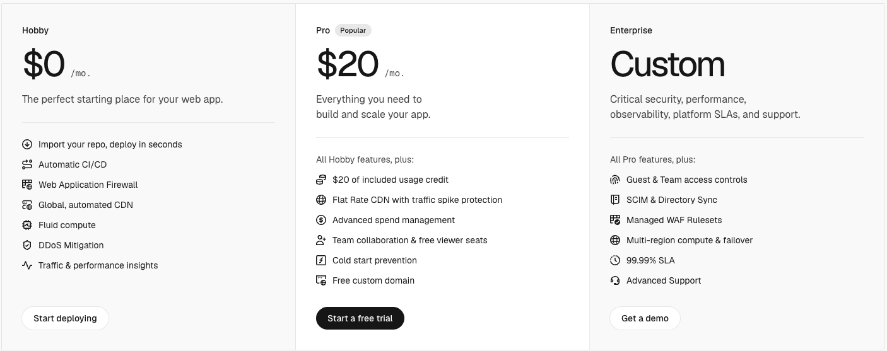
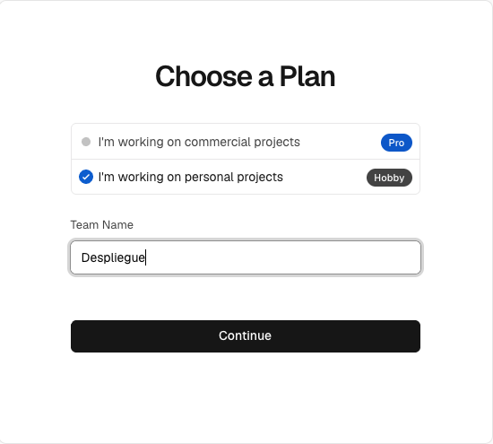

# Más opciones para el despliegue en la nube (WIP)

## Despliegue estático y despliegue dinámico

Para empezar, lo que tenemos que valorar es si el contenido que necesitamos desplegar en la nube es estático o es dinámico. Es decir, si necesitamos backend o no. Incluso podemos valorar desplegar nuestra aplicación en diferentes servicios, si la planificamos bien, teniendo la parte estática en los servidores de contenido estático (que suelen ser más económicos) y la parte dinámica en los servidores dinámicos. Esta opción es más insegura y requiere comunicación constante entre frontend y backend a través de la red. De hecho, lo que hacemos es dividir la aplicación en dos (o más) aplicaciones separadas. Pero puede ser algo a tener en cuenta.

En cualquier caso, debemos sopesar las opciones que tenemos. Para el despliegue estático, Vercel, Netlify y GithubPages son buenas opciones, aunque con limitaciones.

Para el despliegue dinámico, ya conocemos Render (probablemente la mejor opción), pero también disponemos de Railway y SnapDeploy como alternativas.

Además, contamos con Supabase y MongoDB Atlas como opciones para el despliegue de los servidores de base de datos.

## Vercel

Vercel ofrece los siguientes planes:



Para empezar a desplegar, simplemente nos metemos en la [**página web**](https://vercel.com/) y le damos a la opción `Deploy now`. Iniciamos sesión con, por ejemplo, nuestra cuenta de github, y continuamos el proceso.



Podemos importar los archivos desde nuestros repositorios si instalamos la aplicación de Vercel en Github. Recuerda que el repositorio debe tener un index.html como página de entrada. Al ser una página estática, no necesita nada especial, pero no funcionará nada realizado a través del servidor. Es decir, no funcionarán cosas como Thymeleaf.

> **ACTIVIDAD:** Despliegua una página web sencilla en Vercel

## GithubPages

[GitHub Pages](https://pages.github.com/) es un servicio gratuito de GitHub que permite alojar sitios web directamente desde un repositorio. Es especialmente útil para sitios personales, documentación de proyectos, portafolios y proyectos estáticos. Los sitios alojados pueden usar HTML, CSS, JavaScript u otros generadores estáticos como Jekyll.

Documentación oficial:
[https://docs.github.com/en/pages](https://docs.github.com/en/pages)

### 1. Crear un repositorio en GitHub

1. Inicia sesión en [github.com](https://github.com).
2. Haz clic en el botón "New" o "New repository".
3. Asigna un nombre al repositorio (por ejemplo, `mi-sitio`).
4. Puedes marcar la opción "Add a README file" si lo deseas.
5. Haz clic en "Create repository".

### 2. Agregar los archivos del sitio

Sube tus archivos HTML, CSS y otros necesarios al repositorio. Puedes hacerlo de dos formas:

**Opción A**: Usando la interfaz web

* Entra al repositorio.
* Haz clic en "Add file" > "Upload files".
* Sube los archivos y haz commit.

**Opción B**: Usando Git localmente
Si prefieres usar la terminal:

```bash
git clone https://github.com/tu-usuario/mi-sitio.git
cd mi-sitio
# Agrega tus archivos
git add .
git commit -m "Sitio inicial"
git push origin main
```

Github pages también **admite archivos en formato markdown**, que son traducidos por el framework Jekyll a HTML.

### 3. Activar GitHub Pages

1. Ve al repositorio en GitHub.
2. Haz clic en la pestaña "Settings".
3. En el menú lateral, busca "Pages" (en la sección "Code and automation").
4. En la sección "Source", selecciona la rama (`main` o `master`).
5. Luego elige la carpeta raíz (`/root`) o `/docs` si tu contenido está en esa carpeta.
6. Haz clic en "Save".

GitHub generará una URL para tu sitio, algo como:

```
https://tu-usuario.github.io/mi-sitio/
```

Puede tardar unos segundos en estar disponible.

### 4. Actualizar el sitio

Cada vez que hagas un nuevo *commit* y *push* a la rama configurada, GitHub Pages actualizará automáticamente el sitio.

> **Consideraciones adicionales**
>
>* El sitio debe ser estático. GitHub Pages no ejecuta código del lado del servidor (como PHP).
>* Si deseas usar un generador estático como Jekyll, GitHub Pages lo soporta de forma nativa.
>* También puedes usar un dominio personalizado.

> **Recursos adicionales**
> 
> * Guía completa de GitHub Pages:
>   [https://docs.github.com/en/pages](https://docs.github.com/en/pages)
> 
> * Personalizar sitios con Jekyll:
>   [https://docs.github.com/en/pages/setting-up-a-github-pages-site-with-jekyll](https://docs.github.com/en/pages/setting-up-a-github-pages-site-with-jekyll)

> **ACTIVIDAD:** Crea una página web estática en github pages. Usa archivos markdown para generar contenido, así como HTML, CSS y Javascript.

## Netlify

Netlify es una plataforma de despliegue que permite desplegar estático, aunque tiene opciones para bases de datos y una gran cantidad de aplicaciones de inteligencia artificial. El proceso de creación de tu sitio web es muy similar (si no igual) al de Vercel. Para empezar, [**conéctate a la web de Netlify**](https://www.netlify.com/) y pulsa en `Start building`. De nuevo, inicia sesión con, por ejemplo, tu cuenta de Github.

Puedes sincronizar un repositorio de github con Netlify y darle acceso.

> **ACTIVIDAD:** Sube una página de las anteriores a Netlify.

> **ACTIVIDAD:** Analiza las ventajas, inconvenientes y cosas comunes que tienen estas tres plataformas de cara a tu posible futuro proyecto intermodular.

## Railway

## SnapDeploy

## Supabase

## MongoDB